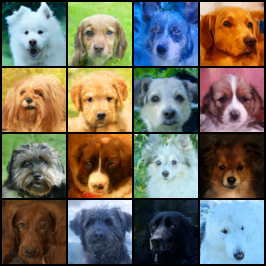
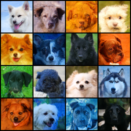
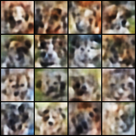
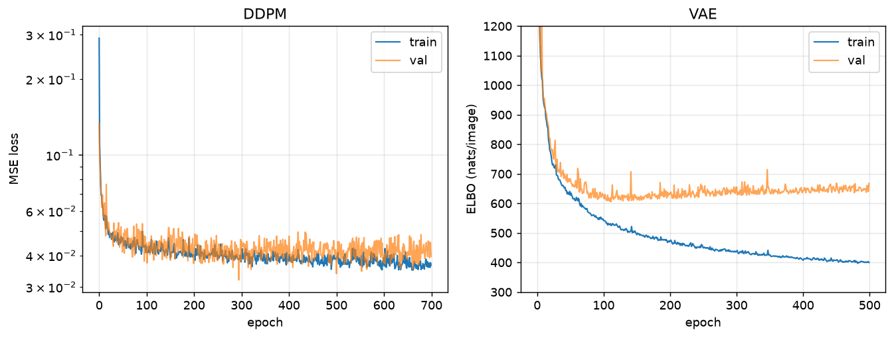

# thisdogdoesnotexist

A denoising diffusion model (DDPM) and a convolutional VAE, both implemented from
scratch in PyTorch and trained on the same 4,739 dog faces at 64×64. The point of the
project is the comparison: same data, same preprocessing, same evaluation, and an
explanation of why one produces sharp samples and the other does not.

---

## Samples

**DDPM** — 700 epochs (~26k steps), EMA weights, 1000-step ancestral sampling.

<p align="center">
  
  
</p>

**VAE** — best-validation checkpoint (epoch 111), sampled from the N(0, I) prior.

<p align="center">
  
</p>

Each grid is 16 unconditional samples from a fixed seed, not cherry-picked.

---

## Results

| | FID ↓ | parameters | training | sampling cost |
|---|---|---|---|---|
| **DDPM** | **TBD** | 18.5M | 700 epochs, 7.3 GPU-h | 1000 forward passes / image |
| **VAE** | TBD | 8.7M | 500 epochs, ~3.3 GPU-h | 1 forward pass / image |

FID computed with [`clean-fid`](https://github.com/GaParmar/clean-fid) on 10,000
generated samples against all 4,739 training images, both at 64×64 through the same
preprocessing path. `clean-fid` is used specifically because differences in image
resizing between FID implementations can shift the score by more than 10 points, which
makes numbers from different codebases non-comparable.

The sampling-cost column is not a footnote. Generating 10,000 DDPM samples took
**9.5 GPU-hours**; the VAE produced the same number in seconds. Diffusion buys sample
quality with roughly a 1000× increase in inference cost.

---

## Why the VAE is blurry

This is the central question the project is built around, and it has two answers that
compound.

**The reconstruction term is an averaging objective.** The VAE's loss is the ELBO,
and its reconstruction term is a Gaussian log-likelihood, which reduces to mean squared
error. Given a latent code `z` that is consistent with many plausible images, the output
that minimises MSE is not any one of them — it is their *mean*. An average of several
dogs is a blurry dog. The model is not failing; it is doing exactly what the objective
asks.

**The bottleneck is lossy and there is no way back.** Every image is compressed to 128
numbers before being reconstructed. That discards most of the high-frequency detail, and
the decoder has no path to recover it. The UNet used by the diffusion model never
compresses: it stays at full resolution through skip connections at every level, so fine
texture survives.

The diffusion model avoids the averaging problem entirely because it is not asked to
reconstruct anything. It predicts the noise that was added to an image at a known
corruption level — a task that has a well-defined answer and no incentive to hedge
between alternatives.

---

## Method

**Data.** AFHQ, dog domain only: 4,739 training and 500 validation images, downsampled
to 64×64. AFHQ was chosen over Stanford Dogs because the faces are aligned, which a VAE
needs — unaligned subjects produce mush — and over CelebA because animal faces avoid the
consent and licensing questions attached to scraped photographs of people. Images are
stored as uint8 and normalised to `[-1, 1]` in exactly one place (`src/data.py`).
Horizontal flip is the only augmentation.

**Diffusion process.** Cosine noise schedule (Nichol & Dhariwal), T = 1000. The forward
process uses the closed form `x_t = √ᾱ_t · x₀ + √(1−ᾱ_t) · ε`, so any timestep is
reachable in a single step. Training follows Algorithm 1 of Ho et al.: sample a random
`t` per image, corrupt, and regress the network's output onto the noise that was used.

**Architecture.** An 18.5M-parameter UNet: base width 64, channel multipliers
`[1, 2, 2, 4]`, two residual blocks per resolution, self-attention at 16² and 8²
(11 attention blocks in total). Timesteps enter through a sinusoidal embedding followed
by a shared MLP, and each residual block projects that vector to its own channel count
and adds it as a per-channel bias — the mechanism by which one set of weights handles
1000 different denoising problems.

**Training.** Adam at 2e-4, batch size 128, mixed precision, EMA of the weights with
decay 0.9999 and a warmup ramp. All samples are generated from the EMA weights.
Both models were trained on a single Kaggle T4.

**Gates.** Before either full run, each model had to overfit 100 images. Generative
models fail silently — a bug and "not trained enough" look identical — so the gate is
the cheapest way to separate the two. The DDPM's loss fell from 0.755 to 0.023 on that
set, 15× below the score of the trivial "echo the input" solution.

---

## Training curves

<p align="center">
  
</p>

The two models overfit completely differently, and the reason is structural.

The **VAE** reaches its best validation loss at epoch 111 and never improves again, while
training loss continues to fall for another 390 epochs. The gap grows from 32 to 242.
It sees the same `(image → reconstruction)` target every epoch and memorises it.

The **DDPM** shows almost no gap at all. Each image is paired with a different random
timestep and fresh noise on every pass, so the model effectively never sees the same
training example twice. At 26k steps on 4,739 images it has barely begun to overfit.

Note the y-axes are not comparable — the DDPM reports an MSE on noise, the VAE reports
an ELBO in nats per image.

---

## Two things worth reporting

**Lower validation loss selected a worse model.** The run's best-validation checkpoint
(epoch 294) produced samples with heavy magenta and green colour casts; the final
checkpoint (epoch 699), with a *higher* validation loss, produced natural colour. The
apparent improvement was noise: the validation loss resamples `t` and the noise every
epoch, and the 100-epoch block means for epochs 200–299 and 600–699 are identical
(0.0414 and 0.0416). Checkpoint selection by validation loss is unreliable here. The
diffusion objective averages over 1000 timesteps and is dominated by the high-noise end,
where predicting the noise is nearly trivial, so it plateaus early while the low-noise
cases that determine fine texture keep improving.

**The samples are not copies of the training set.** Memorisation is a documented failure
mode for diffusion models on small datasets, so it was checked rather than assumed. For
each generated image, the nearest training image by L2 distance shares colour palette and
pose but is a different animal. Generated samples sit slightly *closer* to the training
set than real images do to each other (21.5 vs 25.6 mean L2), which reflects their
smoothness rather than memorisation — a blend of training images would be blurry, and
these are not.

---

## Limitations

- **Undertrained by diffusion standards.** 26k optimizer steps against the 800k used in
  the original DDPM paper. Samples would continue to improve with more compute.
- **Background colour casts.** Facial structure and fur texture are learned well;
  overall colour is low-frequency content that is learned late, and at this budget it is
  often wrong.
- **Horizontal band artifacts** appear in a minority of samples. Measuring out-of-range
  pixels per row ruled out output clipping as the cause; the bands originate in the
  model's output, most likely in the nearest-neighbour upsampling path.
- **Not an equal-compute comparison.** The VAE converged in ~111 epochs and was given no
  more; the DDPM was still improving at cutoff, so its FID is an upper bound.
- **Backgrounds are weak.** AFHQ is face-aligned, so facial structure is highly
  consistent across the dataset and learned quickly, while backgrounds have no shared
  structure and get whatever capacity is left.

---

## Repository

```
config.yaml              every hyperparameter; a result traces to one file
src/
  data.py                dataset + the only normalisation in the project
  ema.py                 exponential moving average with warmup
  models/
    vae.py               encoder, decoder, ELBO
    unet.py              UNet, residual blocks, attention, time embedding
    ddpm.py              noise schedule, q_sample, p_sample, sampling loop
  train_vae.py
  train_ddpm.py
  eval_fid.py            sample dumping + FID
notebooks/               thin: load a checkpoint, make figures. No model code.
assets/                  the committed figures
```

### Running it

```bash
pip install -r requirements.txt
# place AFHQ at data/afhq/{train,val}/dog/, or point config.yaml elsewhere
python src/train_ddpm.py
python src/eval_fid.py
```

Paths are anchored to the repository root, so the scripts run from any working
directory. Runs are seeded and reproducible — two runs of the training script produce
byte-identical loss curves.

Trained weights are not in the repository.

---

## References

Worked from:

- Ho, J., Jain, A., Abbeel, P. (2020). *Denoising Diffusion Probabilistic Models.* [arXiv:2006.11239](https://arxiv.org/abs/2006.11239)
- Nichol, A., Dhariwal, P. (2021). *Improved Denoising Diffusion Probabilistic Models.* [arXiv:2102.09672](https://arxiv.org/abs/2102.09672)
- Tomczak, J. M. (2024). *Deep Generative Modeling* (2nd ed.). Springer. [doi:10.1007/978-3-031-64087-2](https://doi.org/10.1007/978-3-031-64087-2)
- Rogge, N., Rasul, K. (2022). *The Annotated Diffusion Model.* [Hugging Face](https://huggingface.co/blog/annotated-diffusion)

Data and metrics:

- Choi, Y., Uh, Y., Yoo, J., Ha, J.-W. (2020). *StarGAN v2: Diverse Image Synthesis for Multiple Domains.* [arXiv:1912.01865](https://arxiv.org/abs/1912.01865) — AFHQ
- Heusel, M., Ramsauer, H., Unterthiner, T., Nessler, B., Hochreiter, S. (2017). *GANs Trained by a Two Time-Scale Update Rule Converge to a Local Nash Equilibrium.* [arXiv:1706.08500](https://arxiv.org/abs/1706.08500) — FID
